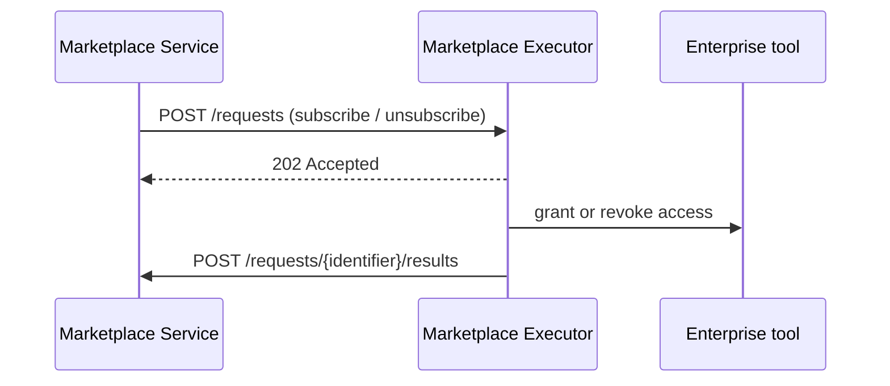

# ODM Platform Marketplace Executor Starter

> A starter project for building a **Marketplace Executor** for the [Open Data Mesh Platform](https://dpds.opendatamesh.org/) —
> grant and revoke access to data products on your enterprise tools.

<p align="center">
  <a href="https://opensource.org/licenses/Apache-2.0"></a>
</p>

<p align="center">
  <a href="https://openjdk.org/"></a>
  <a href="https://quarkus.io/"></a>
</p>

<p align="center">
  <a href="#what-the-executor-does">What the executor does</a> ·
  <a href="#quick-start-local">Quick start</a> ·
  <a href="#run-with-docker">Run with Docker</a> ·
  <a href="#executor-api">Executor API</a> ·
  <a href="#implement-your-executor">Implement your executor</a> ·
  <a href="#cicd">CI/CD</a> ·
  <a href="#contributing">Contributing</a>
</p>

---

## What the executor does

The Marketplace Executor is the component that bridges the **Data Product Catalog** and your enterprise tools. It manages access to the data products listed in the catalog, turning the catalog into a true **Data Product marketplace**.

- The **Marketplace Service** receives an access request (subscribe or unsubscribe) and forwards it to the executor.
- The executor **grants or revokes access** on the target tool. The complexity of orchestrating multiple calls is delegated to it.
- The executor **reports the outcome** back to the Marketplace Service, asynchronously.



This starter is stateless (no database) and is meant to be **forked and customized**.

---

## Quick start (local)

**Requirements:** Java **21** · Maven **3.9+** (or the included `./mvnw`)

```bash
git clone https://github.com/opendatamesh-initiative/odm-platform-adapter-marketplace-executor-starter.git
cd odm-platform-adapter-marketplace-executor-starter

./mvnw quarkus:dev
```

The executor listens on port **9019** (`quarkus.http.port` in `application.yml`). When it is up:

| | Endpoint |
|:--|:---------|
| **Swagger UI** | [http://localhost:9019/swagger-ui](http://localhost:9019/swagger-ui) |
| **OpenAPI** | [http://localhost:9019/api-docs](http://localhost:9019/api-docs) |

Other builds:

```bash
./mvnw package                  # JVM build, runner in target/quarkus-app/
./mvnw -Pnative package         # native build (Mandrel or GraalVM 21)
./mvnw test                     # tests (outbound calls are mocked)
```

---

## Run with Docker

The `Dockerfile` packages the Quarkus **native** executable on `ubi9/ubi-minimal` (port **9019**, non-root user `1001`, no Java needed at runtime). Published images, one per release:

```bash
docker run --rm -p 9019:9019 \
  -e ODM_PRODUCT_PLANE_MARKETPLACE_SERVICE_ADDRESS=http://host.docker.internal:8085 \
  ghcr.io/opendatamesh-initiative/odm-platform-adapter-marketplace-executor-starter:<version>
# also on Docker Hub: opendatamesh/odm-platform-adapter-marketplace-executor-starter:<version>
```

Settings are environment variables (any property of `application.yml`, upper-cased with dots and dashes turned into underscores). For a larger configuration, mount a file at `/work/config/application.yml`, which the executor reads relative to its working directory `/work`.

Build the image locally (needs Docker; no local GraalVM or Mandrel):

```bash
./mvnw package -DskipTests -Dnative -Dquarkus.native.container-build=true
docker build -t odm-platform-adapter-marketplace-executor-starter .
```

---

## Executor API

The Marketplace Service calls a single endpoint:

```
POST {executorBaseUrl}/api/v1/up/marketplace-executor/requests
```

It answers **202 Accepted** and processes the request asynchronously. An invalid request returns **400** with an error body.

<details open>
<summary><strong>Request</strong></summary>

<br>

```json
{
  "v": "1",
  "operation": "MARKETPLACE_SUBSCRIBE | MARKETPLACE_UNSUBSCRIBE",
  "request": {
    "name": "",
    "identifier": "",
    "provider": {
      "dataProductFqn": "",
      "dataProductPortsFqn": [""]
    },
    "consumer": {
      "type": "dataproduct | user | team",
      "identifier": "fqn | email | ?"
    },
    "requester": {
      "type": "user",
      "identifier": "email"
    },
    "properties": {},
    "startDate": "Date",
    "endDate": "Date"
  }
}
```

</details>

<details open>
<summary><strong>Result sent to the Marketplace Service</strong></summary>

<br>

Once processed, the executor posts the result to
`{marketplaceServiceAddress}/api/v1/pp/marketplace/requests/{identifier}/results`:

```json
{
  "status": "PENDING | GRANTED | DENIED | REVOKED | ERROR",
  "message": "",
  "provider": {
    "dataProductFqn": "",
    "dataProductPortsFqn": [""]
  },
  "createdAt": "Date"
}
```

</details>

| Status | Meaning |
|:-------|:--------|
| `PENDING` | The grant process has started but needs additional work |
| `GRANTED` | The permissions have been correctly granted |
| `DENIED` | The grant process has been denied |
| `REVOKED` | The permissions have been correctly revoked |
| `ERROR` | An error occurred during the process |

---

## Implement your executor

1. Fork this repository
2. Implement `MarketplaceAccessOutboundPortImpl` (package `marketplace.services.usecases.processrequest`) with the grant and revoke logic of your enterprise tool
3. Set the Marketplace Service address in `src/main/resources/application.yml`:

```yaml
odm:
  product-plane:
    marketplace-service:
      active: true
      address: http://localhost:8085
```

4. Update the image name in the CI/CD configuration (see [CI/CD](#cicd))
5. Build and deploy your custom executor

**Implementation notes**

- Each request has a unique `identifier` generated by the Marketplace Service
- Keep detailed logs of the resources created during the access grant process
- Implement error handling and rollback as needed
- Access can be time-bound through `startDate` and `endDate`

**Code layout**

| Package | Role |
|:--------|:-----|
| `rest` | JAX-RS resource and error mapping |
| `marketplace.services` | Use cases service: maps API resources to domain commands |
| `marketplace.services.usecases.processrequest` | Use case, ports, adapters, factory |
| `utils`, `exceptions` | Shared utilities from the template |

Conventions live in [`spdd/norms/`](spdd/norms/README.md).

---

## CI/CD

Two GitHub Actions workflows are in `.github/workflows/`:

| Workflow | Runs on | What it does |
|:---------|:--------|:-------------|
| `ci.yml` | Push and pull request to `main` | JDK 21 (Temurin), `./mvnw -B verify` |
| `cicd.yml` | A GitHub release is created | Checks the tag against the POM version, runs the tests, builds the native executable and the Docker image, and pushes it to GitHub Container Registry (`ghcr.io/opendatamesh-initiative/<artifactId>:<version>`, with `GITHUB_TOKEN`) and Docker Hub (`opendatamesh/<artifactId>:<version>`, with the repository secrets `DOCKER_USERNAME` and `DOCKER_PASSWORD`) |

The version check strips every character that is not a digit or a dot from the tag (`v1.0.2` becomes `1.0.2`) and fails if the result differs from the POM version.

**To release:** set the POM version to the release version (no `-SNAPSHOT`), merge to `main`, create a GitHub release with a matching tag (`v1.0.2` or `1.0.2`), then bump the POM to the next `-SNAPSHOT`.

**Executors generated from this starter inherit the `Dockerfile` and both workflows.** The workflow `name` and the `IMAGE_NAME` environment variable are hard-coded to this repository's artifactId (`odm-platform-adapter-marketplace-executor-starter`). After generating a new executor, update `IMAGE_NAME` and the `name` in both `.github/workflows/ci.yml` and `.github/workflows/cicd.yml` to the new artifactId, otherwise its images would be published under the starter's name. Also add the `DOCKER_USERNAME` and `DOCKER_PASSWORD` secrets to the new repository.

---

## Related links

- [Open Data Mesh Architecture](https://platform.opendatamesh.org/architecture/)
- [ODM Initiative Discussion](https://github.com/orgs/opendatamesh-initiative/discussions/1)

---

## Contributing

This is a starter project intended to be forked and customized.

1. Fork the repository and create a feature branch
2. Make your changes with clear commits
3. Open a pull request against the main branch

Questions or proposals → [ODM Initiative Discussion](https://github.com/orgs/opendatamesh-initiative/discussions/1).

---

## License

Licensed under the [Apache License 2.0](https://www.apache.org/licenses/LICENSE-2.0).

Part of the [Open Data Mesh Initiative](https://github.com/opendatamesh-initiative).
